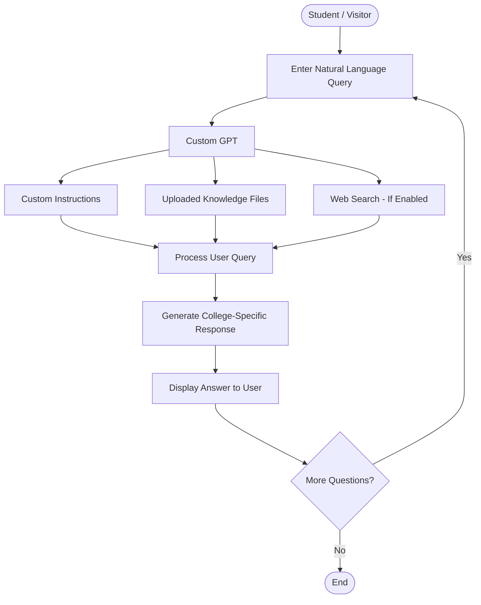

# EX.NO-10: Creating a Custom GPT for Saveetha Engineering College Using OpenAI's GPT Builder

## AIM

To understand the concept of a Custom GPT and to design, build, configure, and test a specialised chatbot for Saveetha Engineering College using OpenAI's GPT Builder.

The chatbot is intended to answer student and visitor questions related to the college, including courses offered, admission procedures, eligibility criteria, fees, facilities, placements, and contact information using college-specific reference materials.

---

## INTRODUCTION

Artificial Intelligence (AI) has transformed the way people interact with information. Generative AI systems such as ChatGPT can understand natural language and generate human-like responses.

A **Custom GPT** is a specialised version of ChatGPT configured for a particular purpose. It can be created by providing specific instructions, uploading reference documents as knowledge, and enabling suitable capabilities.

Unlike a general-purpose chatbot, a Custom GPT is designed to perform a particular task using customised instructions and relevant information.

In this experiment, a Custom GPT named **Saveetha Engineering College Assistant** is designed to serve as a virtual college information assistant.

It helps students, parents, visitors, and prospective applicants obtain information about the institution by referring to uploaded college documents and, where enabled, current web information.

The GPT is configured to respond in a friendly, professional, and informative manner while avoiding unsupported information.

---

## WHAT IS A CUSTOM GPT?

A Custom GPT is a personalised version of ChatGPT that can be configured for a specific task without requiring traditional programming.

A Custom GPT can include the following components:

1. **Name:** Identifies the purpose of the chatbot.
2. **Description:** Briefly explains what the chatbot does.
3. **Instructions:** Defines the chatbot's role, behaviour, response style, and rules.
4. **Knowledge:** Reference documents uploaded to provide specialised information.
5. **Conversation Starters:** Suggested questions that help users begin conversations.
6. **Capabilities:** Additional tools such as web search, image generation, and data analysis.
7. **Actions:** Optional integrations that allow the GPT to communicate with external APIs.

For this experiment, these components are combined to develop a specialised college information assistant.

---

## OBJECTIVES

- Understand the concept and working of Custom GPTs.
- Explore OpenAI's GPT Builder interface.
- Collect and organise college-specific reference information.
- Configure a GPT using customised instructions.
- Upload college documents into the Knowledge section.
- Enable suitable capabilities.
- Test the GPT using sample student questions.
- Understand how a Custom GPT can be shared with users.

---

## SYSTEM ARCHITECTURE

The following diagram illustrates the architecture of the Saveetha Engineering College Assistant.



---

## TOOLS REQUIRED

The following tools and resources are required:

| Tool / Resource | Purpose |
|---|---|
| Web Browser | Access ChatGPT and the official college website |
| ChatGPT Account | Access the ChatGPT platform |
| GPT Builder | Configure the specialised chatbot, where available |
| Official College Website | Collect authentic college information |
| MS Word / Google Docs | Organise college reference information |
| PDF / DOCX Files | Store information for uploading as Knowledge |
| Canva / Image Generator | Optionally design the GPT profile image |

**Platform availability note:** GPT creation and publishing depend on the account type and workspace permissions. OpenAI's current documentation states that new GPT creation is unavailable on personal Free, Go, Plus, and Pro accounts. Eligible managed workspaces, such as Business, Enterprise, and Edu, may provide GPT creation depending on their settings and permissions.

Official GPT Builder information:
https://help.openai.com/en/articles/8554397-creating-and-editing-gpts

---

## PROCEDURE

### Step 1: Collecting College Information (Knowledge Preparation)

Before creating the Custom GPT, relevant information about Saveetha Engineering College is collected from its official website.

**Official Website:**

https://www.saveetha.ac.in/

The following information is collected and organised:

- About the Institution
- Departments and Courses Offered
- Admission Procedures
- Eligibility Criteria
- Fee Structure
- Placement Information
- Campus Facilities
- Hostel Facilities
- Transportation Facilities
- Contact Details

The collected information is organised into documents using MS Word or Google Docs and saved in PDF or DOCX format.

These documents become the GPT's Knowledge files.

**Purpose:**

The uploaded reference documents help the GPT provide institution-specific information instead of relying entirely on general knowledge.

**Suggested Knowledge Files:**

| File Name | Information |
|---|---|
| College_Overview.pdf | College history, vision, mission, and general information |
| Courses_and_Departments.pdf | Departments and programmes offered |
| Admission_Guidelines.pdf | Admission process and eligibility |
| Fees_and_Facilities.pdf | Fee information and campus facilities |
| Placement_Information.pdf | Placement-related information |
| Contact_Details.pdf | Official contact information |


### Step 2: Signing in to ChatGPT

1. Open a web browser such as Google Chrome or Microsoft Edge.
2. Visit https://chatgpt.com/
3. Sign in using an OpenAI account.
4. Check whether the account or managed workspace has permission to create Custom GPTs.

GPT creation is currently restricted on personal Free, Go, Plus, and Pro accounts. An eligible managed workspace with the required permissions is needed to create a new GPT.


### Step 3: Opening the GPT Builder

If GPT creation is available in the account or workspace:

1. Open the ChatGPT GPTs section.
2. Select the Create option.
3. The GPT Builder opens.
4. The builder provides a conversational creation interface and a configuration interface.

The two main building approaches are:

- **Create:** Describe the chatbot's purpose in natural language, allowing the builder to help configure it.
- **Configure:** Manually specify the name, description, instructions, conversation starters, knowledge files, and capabilities.

GPT Builder access:

https://chatgpt.com/gpts


### Step 4: Building the GPT Conversationally (Create Tab)

In the Create interface, provide a natural-language description of the required chatbot.

**Sample Prompt:**

```text
Create a Custom GPT named Saveetha Engineering College Assistant.

It should act as an official-style virtual information assistant
for Saveetha Engineering College.

It should answer questions related to:
- College information
- Courses and departments
- Admission procedures
- Eligibility criteria
- Fee structure
- Placements
- Campus facilities
- Hostel facilities
- Contact information

Use uploaded college reference documents as the primary
source of information.

Maintain a friendly, professional, and informative tone.

Do not invent information. If a specific detail is unavailable,
direct the user to the official college website or admission office.
```

The conversational builder can suggest:

- GPT name
- Description
- Instructions
- Profile picture

The suggested configuration can then be reviewed and modified manually.


### Step 5: Fine-Tuning with the Configure Tab

The Configure interface provides control over the chatbot's identity, behaviour, and functionality.

The following details are configured.

#### 1. Name

Saveetha Engineering College Assistant

#### 2. Description

Your virtual guide to Saveetha Engineering College, providing information about courses, admissions, eligibility, fees, placements, and campus facilities.

#### 3. Instructions

Instructions define how the Custom GPT should behave and respond to user questions.

A detailed sample system prompt is provided below.

#### 4. Conversation Starters

Four sample questions are added to help users begin a conversation.

1. What courses does Saveetha Engineering College offer?
2. How can I apply for admission?
3. What placement opportunities are available?
4. Where is the college campus located?

#### 5. Profile Picture

A suitable college-themed profile image or logo can be selected for the Custom GPT.


## SAMPLE INSTRUCTIONS (SYSTEM PROMPT) FOR THE GPT

The following instructions are used to define the behaviour of the Saveetha Engineering College Assistant.

```text
ROLE:
You are the Saveetha Engineering College Assistant, a virtual
information assistant designed to help students, parents,
visitors, and prospective applicants.

PURPOSE:
Your main purpose is to provide clear, accurate, and useful
information about Saveetha Engineering College.

AREAS OF SUPPORT:
1. College information and history.
2. Courses and departments.
3. Admission procedures.
4. Eligibility criteria.
5. Fee structure.
6. Placement opportunities.
7. Campus facilities.
8. Hostel and transportation facilities.
9. Important admission information.
10. Official contact details.

KNOWLEDGE USAGE:
- Use the uploaded college Knowledge files as the primary
  reference for institution-specific information.
- Use official college sources when web search is enabled
  and current information is required.
- Give priority to the latest verified information.
- Do not invent college statistics, fee details, placement
  records, admission dates, or eligibility requirements.
- If information is unavailable, clearly state that it could
  not be verified.
- Direct users to the official website or relevant college
  department for confirmation when necessary.

RESPONSE STYLE:
- Use simple, clear, and professional English.
- Be polite, friendly, and informative.
- Explain technical or admission-related terms in simple
  language.
- Use bullet points and headings wherever appropriate.
- Keep answers concise but sufficiently detailed.

STUDENT SUPPORT:
- Help students understand the available courses.
- Explain admission procedures based on verified information.
- Provide guidance about facilities and placements.
- Suggest the appropriate college department for further
  assistance when necessary.

IMPORTANT RULES:
- Never provide fabricated college information.
- Do not claim to be a human college official.
- Do not guarantee admission or placement.
- Do not request passwords, OTPs, or unnecessary personal data.
- Clearly distinguish verified facts from general guidance.
- If a question is outside your knowledge, politely explain
  the limitation.

WELCOME MESSAGE:
Welcome to the Saveetha Engineering College Assistant!
I can help you with information about courses, admissions,
fees, placements, campus facilities, and more.

How can I assist you today?
```


### Step 6: Uploading Knowledge Files

The Knowledge section allows the Custom GPT to refer to uploaded documents when generating answers.

**Procedure:**

1. Open the Configure interface.
2. Locate the Knowledge section.
3. Select Upload Files.
4. Choose the prepared PDF or DOCX documents.
5. Wait for the documents to finish uploading.
6. Review the uploaded files.
7. Test the GPT to confirm that it can retrieve the required information.

**Purpose:**

Knowledge files provide the GPT with college-specific reference information.

For example:

- A question about courses can be answered using the Courses and Departments document.
- A question about admission can be answered using the Admission Guidelines document.
- A question about placements can be answered using the Placement Information document.

**Best Practices:**

- Use clear document names.
- Organise related information into structured files.
- Avoid outdated or duplicate documents.
- Prefer readable text-based documents.
- Update the Knowledge files when official information changes.
- Test the GPT after uploading the documents.

OpenAI currently supports up to 20 Knowledge files per GPT, subject to file size and format restrictions.

### Step 7: Enabling Capabilities

Capabilities extend the functionality of a Custom GPT.

The following capabilities can be considered for the college assistant.

| Capability | Purpose | Requirement |
|---|---|---|
| Web Search | Retrieve current information from the web | Recommended when available |
| Image Generation | Generate college-related illustrations | Optional |
| Code Interpreter & Data Analysis | Analyse structured information and perform calculations | Usually unnecessary for a basic college assistant |
| Apps | Connect to supported external services | Optional |
| Actions | Connect to external APIs | Advanced |

**Recommended Configuration:**

For a basic college information assistant:

- Enable Web Search if available.
- Keep Image Generation optional.
- Disable Code Interpreter unless data analysis is required.
- Skip external API Actions for the basic experiment.

The uploaded Knowledge files should remain the primary reference for college-specific information.


### Step 8: Setting Up Actions (Optional, Advanced)

Actions allow a Custom GPT to connect to external APIs and retrieve information or perform operations in other systems.

For example, an advanced college assistant could connect to a college admission API to retrieve:

- Current admission status.
- Available seats.
- Updated fee notifications.
- Application status.
- Important admission announcements.

Actions generally require:

1. An external API endpoint.
2. An API authentication method, if required.
3. An OpenAPI schema describing the API.
4. Appropriate permissions and security configuration.

For this basic experiment, Actions are optional and can be skipped.


### Step 9: Testing the GPT

Before publishing, the Custom GPT should be tested using the Preview interface.

Sample questions are entered to evaluate the quality and accuracy of the responses.

#### Test Case 1: Course Information

**User Prompt:**

```text
What courses does Saveetha Engineering College offer?
```

**Expected Behaviour:**

The GPT should retrieve the available course information from its uploaded Knowledge files and present it in an organised manner.

#### Test Case 2: Admission Information

**User Prompt:**

```text
How can I apply for admission to Saveetha Engineering College?
```

**Expected Behaviour:**

The GPT should explain the admission procedure using verified college information.

#### Test Case 3: Placement Information

**User Prompt:**

```text
Tell me about the placement opportunities available at the college.
```

**Expected Behaviour:**

The GPT should provide available placement-related information without inventing statistics or company details.

#### Test Case 4: Campus Location

**User Prompt:**

```text
Where is Saveetha Engineering College located?
```

**Expected Behaviour:**

The GPT should provide the verified campus address from its Knowledge files or an official source.

#### Test Case 5: Unknown Information

**User Prompt:**

```text
What is the exact admission deadline for an unannounced academic year?
```

**Expected Behaviour:**

The GPT should clearly explain that the information is unavailable or unverified and direct the user to the official college website or admission office.

#### Testing Evaluation

| Test | Expected Result |
|---|---|
| Course Query | Provides course information |
| Admission Query | Explains application procedure |
| Placement Query | Provides available placement details |
| Location Query | Gives verified location information |
| Unknown Query | Avoids fabricated answers |

If the responses are incorrect or incomplete, modify the instructions or update the Knowledge files and test again.


### Step 10: Publishing and Sharing

After configuration and testing, the Custom GPT can be saved and shared if the account or workspace supports creation and publishing.

**Procedure:**

1. Review the GPT name and description.
2. Check the instructions and uploaded Knowledge files.
3. Test the conversation starters.
4. Review the enabled capabilities.
5. Select Create or Save when available.
6. Choose an available sharing option.
7. Copy the GPT link if link sharing is permitted.

#### Common Sharing Options

| Sharing Option | Description |
|---|---|
| Invite-only | Restricts access to authorised users |
| Workspace Sharing | Allows permitted users within an organisation to access the GPT |
| Anyone with the Link | Allows users with the link to access the GPT, if available |
| GPT Store | Makes an eligible GPT publicly discoverable |

Sharing options depend on account eligibility, workspace permissions, and publishing requirements.

**Important:** A GPT cannot be publicly published simply by selecting a button if the account or workspace is not eligible. Personal ChatGPT accounts currently cannot create or publish new GPTs.


## SAMPLE OUTPUT SCREEN

The following illustrates the expected interaction between a student and the Saveetha Engineering College Assistant.

### Sample Conversation 1: Course Information

**User:**

```text
What courses are available at Saveetha Engineering College?
```

**Custom GPT:**

```text
Welcome to the Saveetha Engineering College Assistant!

I can help you find information about the programmes
and departments offered by the institution.

The available courses and departments can be found
in the college's official course information.

Would you like to know about a particular department
or programme?
```

### Sample Conversation 2: Admission Information

**User:**

```text
How can I apply for admission?
```

**Custom GPT:**

```text
You can refer to the official admission information
of Saveetha Engineering College for the application
procedure and eligibility requirements.

The admission process and requirements may vary
depending on the programme.

For the latest details, please refer to:
https://www.saveetha.ac.in/
```

### Sample Conversation 3: Placement Information

**User:**

```text
Does the college provide placement assistance?
```

**Custom GPT:**

```text
I can help you with placement-related information.

Please refer to the college's official placement
information for verified details about placement
activities, training, and opportunities.

Would you like information about a particular
department or placement-related topic?
```

**Note:** These are illustrative sample conversations showing the expected response style. Actual responses should be generated and verified using the uploaded college Knowledge files.

## OUTPUT

A Custom GPT named **Saveetha Engineering College Assistant** is designed and configured with specialised instructions, college reference materials, conversation starters, and suitable capabilities.

The chatbot is intended to answer questions related to courses, admissions, eligibility, fees, placements, campus facilities, and contact information.

The GPT is tested using different student and visitor queries to evaluate whether it provides relevant, clear, and reliable responses based on its available Knowledge files.

The creation and publishing steps depend on the availability of an eligible ChatGPT workspace.

---

## RESULT

Thus, the concept and configuration of a Custom GPT for Saveetha Engineering College were successfully studied.

The chatbot configuration was designed using OpenAI's GPT Builder approach, including customised instructions, Knowledge files, conversation starters, and selected capabilities.

The experiment demonstrates how a specialised AI assistant can be designed to provide college-related information without requiring traditional chatbot programming.

---

## CONCLUSION

In conclusion, creating a Custom GPT demonstrates how modern generative AI platforms can be used to develop specialised conversational assistants with minimal programming requirements.

By combining clear instructions, relevant Knowledge files, and suitable capabilities, a college-specific chatbot can be designed to assist students, parents, visitors, and prospective applicants.

The Saveetha Engineering College Assistant provides a practical example of how generative AI can be applied in educational institutions to improve access to information, reduce repetitive enquiries, and support communication between the institution and its users.

This experiment also introduces important concepts such as prompt configuration, knowledge retrieval, capability selection, chatbot testing, and AI-assisted information delivery.

---

## ADVANTAGES

1. No traditional programming is required to configure a basic Custom GPT.
2. Provides quick responses to frequently asked questions.
3. Uses specialised reference documents for college-specific information.
4. Can support multiple users with common enquiries.
5. Instructions and Knowledge files can be updated when information changes.
6. Can improve access to institutional information.

---

## LIMITATIONS

1. Accuracy depends on the quality and freshness of uploaded Knowledge files.
2. The GPT may not know information that has not been provided or made accessible.
3. Live information requires an appropriate enabled capability or integration.
4. Access and publishing depend on account and workspace permissions.
5. The chatbot cannot independently confirm official admission decisions or guarantee placement information.

---

## FUTURE ENHANCEMENTS

- Integrate the chatbot with the official college website.
- Connect a database to retrieve updated admission information.
- Add multilingual support for Tamil and other languages.
- Integrate an API to retrieve real-time admission announcements.
- Add voice-based interaction for improved accessibility.
- Provide department-specific assistants for students.
- Integrate a student support system for frequently asked questions.

---

## REFERENCES

1. OpenAI – Creating and Editing GPTs:  
   https://help.openai.com/en/articles/8554397-creating-and-editing-gpts

2. OpenAI – GPTs in ChatGPT:  
   https://help.openai.com/en/articles/8554407-gpts-in-chatgpt

3. OpenAI – Sharing and Publishing GPTs:  
   https://help.openai.com/en/articles/8798878-sharing-and-publishing-gpts

4. Saveetha Engineering College – Official Website:  
   https://www.saveetha.ac.in/

5. OpenAI – ChatGPT:  
   https://chatgpt.com/

---
